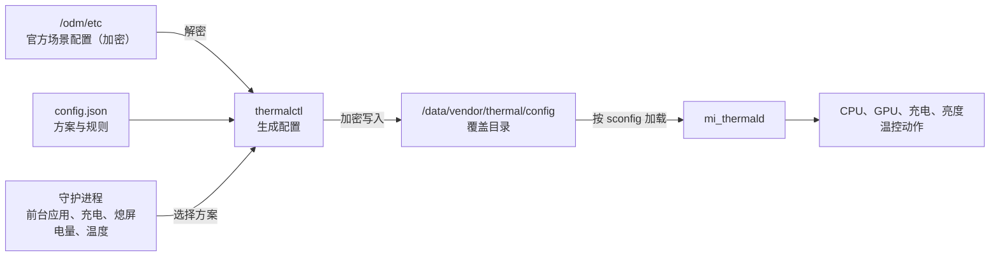

<div align="center">

# 小米温控调度

**Mi Thermal Scheduler**

适用于小米与 Redmi 设备的 KernelSU 温控调度模块

[](https://github.com/MiChongs/MiThermalScheduler/releases/latest)
[](https://github.com/MiChongs/MiThermalScheduler/releases)
[](LICENSE)
<br>


[功能](#功能) | [内置方案](#内置方案) | [安装](#安装) | [使用说明](#使用说明) | [工作原理](#工作原理) | [构建](#从源码构建) | [常见问题](#常见问题)

</div>

---

## 简介

小米温控调度是运行于 KernelSU 的温控管理模块，后端使用 Rust 实现，前端为 Material 3 风格的 WebUI。

模块通过 `mi_thermald` 的配置覆盖目录 `/data/vendor/thermal/config` 生效，不修改系统分区。温控配置在运行时以本机官方配置为基础生成，系统更新后无需重新配置。

模块提供多套预设方案，支持按前台应用与系统状态切换方案，并包含过热保护、充电加速、应用刷新率锁定、Joyose 游戏调度调整、覆盖文件校验恢复，以及单条规则级别的编辑功能。

> [!IMPORTANT]
> 调整温控策略会改变设备的发热与功耗表现。请在了解相关风险后使用，并保持过热保护处于启用状态。

## 功能

<table>
<tr>
<td width="50%" valign="top">

### 方案管理
- 8 套内置方案，涵盖续航、日常、游戏、快充等使用场景
- 自定义方案，支持按类别调整阈值或移除规则
- CPU 降频下限与 GPU 降频等级上限
- 场景锁定与逐场景设置
- 逐条规则、逐档位编辑触发温度、解除温度与目标值
- 生成预览并与官方配置对比

</td>
<td width="50%" valign="top">

### 方案调度
- 常驻守护进程，按设定顺序选择方案
- 支持前台应用、充电、熄屏、低电量、高温等条件
- 场景规则按列表顺序匹配，可启用、停用与排序
- 温度与电量条件设有回差，避免频繁切换
- 应用刷新率锁定
- 充电加速，亮屏使用时保持快速充电
- Joyose 游戏调度调整，可放宽温控限帧并提高 CPU 上限
- 模块描述实时显示运行状态

</td>
</tr>
<tr>
<td width="50%" valign="top">

### 安全机制
- 过热保护：温度超过阈值时临时恢复官方温控
- 写入后校验，`mi_thermald` 无法解析时自动回滚
- 始终保留低电量保护（BCL）与传感器定义
- 覆盖文件被外部修改时自动恢复
- 停用或卸载模块后立即恢复官方温控

</td>
<td width="50%" valign="top">

### WebUI
- 基于 Lit 与 Material 3 组件构建
- 跟随 KernelSU 管理器的动态配色与深色模式
- 实时显示温度、温度趋势与频率上限
- 温控动作日志与模块日志
- 配置导入与导出

</td>
</tr>
</table>

## 内置方案

| 方案 | 风险 | 日常场景 | 游戏与跑分场景 |
| :--- | :---: | :--- | :--- |
| **官方** | 无 | 不做任何修改 | 不做任何修改 |
| **清凉** | 低 | CPU、GPU、NPU 仅留首档；持续限制性能加速；温和充电曲线 | CPU、GPU 推迟到 60°C；游戏充电曲线 |
| **均衡** | 低 | CPU、GPU、NPU 仅留首档；标准充电曲线 | CPU、GPU 推迟到 60°C；游戏充电曲线 |
| **性能** | 中 | 移除 CPU、GPU、NPU 限制；标准充电曲线 | 移除 CPU、GPU、NPU 限制；游戏充电曲线 |
| **极限** | 高 | 仅保留传感器定义与低电量保护 | 同日常场景 |

清凉、均衡、性能三套方案同时移除关核、亮度、网络、高温提示等限制，无线充电改用内置曲线。

- **仅留首档**：保留最轻的一档限制，移除随温度升高的逐级降频。官方日常场景中大核自 25°C 起即降至约 2.7 GHz，此后每升高 1–3°C 再降一档；仅留首档后，频率上限固定在首档。日常场景的 CPU 规则统一采用日常配置的首档，避免相机、视频等场景的首档过低。
- **推迟**：合并为一档，到达指定温度才开始限制。
- **充电曲线**：移除官方的充电限流与 SIC 电流控制，改用内置曲线。标准曲线自 37°C 起逐级限流（官方为 33°C）；游戏曲线在边玩边充时持续轻度限流。

启用过热保护时，推迟或偏移后的触发温度不超过保护触发温度（默认 50°C），且不低于官方设置。传感器定义与低电量保护（BCL）在任何方案下均保持不变。

内置方案不可直接修改。如需调整，请在方案菜单中选择「基于此方案新建」，并在编辑器中分别设置日常场景与游戏场景的策略。

## 兼容性

| 项目 | 要求 |
| :--- | :--- |
| 设备 | 使用 `mi_thermald` 的小米或 Redmi 设备（HyperOS 或 MIUI） |
| 架构 | arm64-v8a |
| Root 方案 | KernelSU（推荐，WebUI 依赖其接口）；Magisk 可以安装，但无法使用 WebUI |
| 配置密钥 | 自动识别旧版与新版配置密钥 |

安装过程会检测设备是否受支持。设备不受支持时，安装将中止，且不会进行任何修改。

已验证设备：Xiaomi 14 Ultra（aurora，骁龙 8 Gen 3，HyperOS 4.0，Android 17）

## 安装

1. 在 [Releases](https://github.com/MiChongs/MiThermalScheduler/releases/latest) 页面下载最新版本的 `MiThermalScheduler-vX.Y.Z.zip`。
2. 在 KernelSU 管理器的「模块」页面选择「从本地安装」，然后选择下载的安装包。
3. 安装完成后重启设备。
4. 在模块列表中打开「小米温控调度」的 WebUI 进行配置。

> [!NOTE]
> 首次安装后，模块处于待机状态，在 WebUI 中启用前不会改动温控。更新模块时，已有方案与规则将保留。

## 使用说明

WebUI 包含以下五个页面：

| 页面 | 内容 |
| :--- | :--- |
| 概览 | 温度、当前方案及其原因、功能状态、温度趋势、频率上限、电池信息 |
| 温控 | 方案选择顺序、方案、场景规则、过热保护、充电加速 |
| 应用 | 应用配置、刷新率锁定、游戏调度（Joyose） |
| 日志 | 温控动作日志与模块运行日志 |
| 设置 | 运行选项、配置导入与导出、关于 |

### 方案选择顺序

守护进程按以下顺序确定当前方案，匹配到第一项后即停止：

1. **过热保护**：温度达到触发温度时使用官方温控，降至恢复温度以下后解除。
2. **应用配置**：前台应用已设置方案时，使用该方案。
3. **场景规则**：按列表顺序匹配充电、熄屏、低电量、高温等条件。
4. **默认方案**。

充电期间，在选定方案的基础上应用充电加速。温控页顶部显示当前生效的环节。

### 温控

- **方案**：轻触方案卡片即可设为默认方案。通过卡片菜单可编辑、复制或删除自定义方案，也可基于内置方案新建方案。
- **场景规则**：在充电、熄屏、低电量或高温时切换到指定方案，按列表顺序匹配，顺序可调整。
- **过热保护**：设置触发温度与恢复温度，默认分别为 50°C 与 46°C。触发温度同时是方案与 Joyose 限帧的放宽上限，确保在达到保护温度之前，温控已按档位逐级生效，切换到官方温控时不会出现性能骤降。
- **充电加速**：充电期间提高充电限流阈值（默认提高 4°C），并可选择移除 SIC-BAT 电流控制。官方规则自温控传感器约 33°C 起限制充电电流，亮屏使用时充电电流通常被限制在 5 A 左右。电量较高（约 75% 以上）时，充电电流主要受电池自身限制。

方案编辑器包含以下页签：

| 页签 | 内容 |
| :--- | :--- |
| 基础 | 名称、描述、图标；日常场景与游戏场景下 11 类规则的处理方式：保持官方、仅留首档、推迟、偏移（可设置起控温度）、替换曲线、移除 |
| 频率 | 各 CPU 簇的降频下限（可选频率取自设备）；GPU 最大降频等级 |
| 场景 | 场景锁定；各场景可选择跟随方案、保持官方或自定义全文 |
| 规则 | 按场景查看全部规则，逐条编辑档位或停用 |
| 预览 | 生成各场景的最终配置，并与官方配置对比 |

### 应用

- **应用配置**：为一个或多个应用指定前台运行时使用的方案与刷新率上限，两项可单独或同时设置。
- **刷新率锁定**：系统会按场景动态限制刷新率（`miui_refresh_rate`），部分游戏会被限制为 60 Hz。锁定期间模块定期检查该值，被系统修改时自动恢复；应用离开前台后恢复为显示设置中选择的刷新率。应用需连续约 6 秒不在前台才视为离开，避免下拉通知栏等操作导致锁定反复解除。
- **游戏调度（Joyose）**：调整系统游戏加速服务的温控限帧与游戏 CPU 上限。

| 项目 | 选项 | 说明 |
| :--- | :--- | :--- |
| 温控限帧 | 官方、放宽、关闭 | 放宽：整体提高温控限帧阈值，包括 PID 温度控制目标；关闭：不再因温度降低帧率 |
| 游戏 CPU 上限 | 官方、提高、满频 | 提高：各簇上限不低于设定值；满频：不限制 CPU 频率上限 |

调整后的配置以设备上最新的官方配置为基础生成，写入后重启 Joyose 生效。启用过热保护时，放宽后的限帧温度不超过保护触发温度。官方配置更新或调整后的配置被覆盖时，模块将自动重新应用；关闭该功能、停用或卸载模块时，将还原官方配置。

> [!TIP]
> 刷新率锁定仅决定系统允许的刷新率上限，游戏实际帧率仍取决于游戏内设置。请选择不超过屏幕最高刷新率的帧率档位，例如在 120 Hz 屏幕上选择 120 帧。

### 日志与设置

- **日志**：查看 `mi_thermald` 最近的调节动作（可按 CPU、GPU、充电筛选）以及模块运行日志。
- **设置**：锁定覆盖文件（`chattr +i`）、检测间隔、重启守护进程、重新应用、导入与导出配置、查看当前加载的配置、恢复官方温控。

## 工作原理



1. `mi_thermald` 根据系统写入的场景编号（`sconfig`）加载对应的场景配置，并优先读取 `/data/vendor/thermal/config` 中的同名文件。
2. 场景配置使用 AES-128-CBC 加密。`thermalctl` 识别本机使用的密钥，解密官方配置并按方案生成新配置，再以相同密钥加密写入覆盖目录。
3. 写入后切换 `sconfig` 使 `mi_thermald` 重新加载，并校验配置能否被正确解析。校验失败时自动恢复官方温控。
4. 守护进程持续检查过热保护、应用配置与场景规则，按需切换方案，并检查覆盖文件是否完整。

配置生成顺序：

```text
官方配置
  1. 场景锁定
  2. 按类别偏移（含起控温度与放宽上限）或移除规则
  3. CPU 降频下限
  4. GPU 降频等级上限
  5. 单条规则修改
  6. 场景全文覆盖
```

传感器定义（`VIRTUAL-SENSOR` 等）与低电量保护（`BCL`）在任何方案下均保持不变。

## 命令行

模块附带的 `thermalctl` 可在终端中使用（需要 root 权限）：

```sh
/data/adb/modules/mi_thermal_m3/bin/thermalctl <命令>
```

| 命令 | 说明 |
| :--- | :--- |
| `summary` | 输出状态摘要 |
| `status` | 输出运行状态（JSON） |
| `info` | 输出设备信息、配置、内置方案与频率表（JSON） |
| `scenes` | 输出官方场景配置的结构化数据（JSON） |
| `preview [--profile ID] [--scene 文件]` | 预览方案生成结果 |
| `save <文件>` | 保存配置并立即生效 |
| `apply` | 重新应用当前配置 |
| `reset` | 停用温控调度并恢复官方温控 |
| `log [-n 数量]` | 输出温控动作与模块日志（JSON） |
| `loaded` | 输出 `mi_thermald` 当前加载的配置 |
| `decrypt <文件>`、`encrypt <输入> <输出>` | 解密或加密温控配置 |
| `joyose status`、`apply`、`restore`、`preview` | 查看、应用、还原或预览 Joyose 配置 |
| `daemon` | 运行守护进程（由 `service.sh` 启动） |

## 目录结构

```text
MiThermalScheduler
├── module/              模块文件（customize、service、uninstall 等脚本）
├── thermalctl/          Rust 后端与守护进程
│   └── src/
│       ├── crypto.rs    配置加密、解密与密钥识别
│       ├── conf.rs      配置解析、序列化与规则分类
│       ├── stock.rs     官方场景配置读取
│       ├── profile.rs   方案、规则与配置生成
│       ├── install.rs   覆盖文件写入、校验与回滚
│       ├── daemon.rs    守护进程
│       ├── refresh.rs   应用刷新率锁定
│       ├── joyose.rs    Joyose 配置调整
│       └── system.rs    温度、频率、电池与前台应用读取
├── webui/               WebUI（Lit 与 esbuild）
├── build.sh             构建与打包脚本
├── update.json          KernelSU 在线更新信息
└── CHANGELOG.md         更新日志
```

运行时数据位于 `/data/adb/mi_thermal_m3/`，包括 `config.json`（方案与规则）、`state.json`（守护进程状态）与 `module.log`（运行日志）。

## 从源码构建

**环境要求**

- Rust（stable）及 `aarch64-linux-android` 目标
- Android NDK（通过 `ANDROID_NDK_HOME` 指定，或安装于 `~/Android/Sdk/ndk`）
- Node.js 18 或更高版本
- `zip`

**构建步骤**

```sh
git clone https://github.com/MiChongs/MiThermalScheduler.git
cd MiThermalScheduler
./build.sh
```

构建脚本依次执行单元测试、交叉编译 `thermalctl`、构建 WebUI，并将安装包输出至 `dist/` 目录。

## 常见问题

<details>
<summary><b>启用后温度没有明显变化</b></summary>

温控规则仅在达到相应温度时触发。可在日志页查看 `mi_thermald` 的调节动作，或在设置页通过「查看当前加载的配置」确认覆盖是否生效。
</details>

<details>
<summary><b>游戏帧率被限制为 60 帧</b></summary>

请先确认游戏内帧率档位不超过屏幕最高刷新率。若游戏提供了高于屏幕刷新率的档位（如 144 帧），请选择 120 帧。然后在应用页为该游戏添加应用配置并设置 120 Hz，以防止系统将其限制为 60 Hz。
</details>

<details>
<summary><b>亮屏充电速度较慢</b></summary>

请在温控页启用充电加速。若充电时运行游戏仍然较慢，可启用「移除 SIC 电流控制」，并注意机身温度。电量较高时充电电流受电池自身限制，属于正常现象。
</details>

<details>
<summary><b>系统更新后是否需要重新配置</b></summary>

不需要。方案在运行时以当前系统的官方配置为基础生成。仅使用「自定义全文」设置的场景需要自行确认内容是否适用。
</details>

<details>
<summary><b>如何确认守护进程正在运行</b></summary>

模块描述会显示运行状态。也可在设置页查看守护进程 PID，或在模块页点击「执行」查看状态摘要。
</details>

<details>
<summary><b>过热保护使用哪个温度</b></summary>

使用 `mi_thermald` 的温控传感器 `VIRTUAL-SENSOR0`。该数值由电池、机身等多个传感器加权计算，接近机身温度。
</details>

<details>
<summary><b>如何完全恢复官方温控</b></summary>

在设置页选择「恢复官方温控」，或在管理器中停用或卸载模块。模块将删除全部覆盖文件，并还原安装前已存在的同名配置。
</details>

## 卸载

在 KernelSU 管理器中卸载模块并重启设备。卸载过程将停止守护进程、删除全部覆盖文件、还原安装前的配置与 Joyose 官方配置，并清除运行时数据。

## 免责声明

本模块按现状提供，不附带任何形式的担保。修改温控策略可能导致设备温度升高、电池老化加快或性能表现变化，由此产生的后果由使用者自行承担。本项目与小米公司无关。

## 许可证

本项目基于 [GNU General Public License v3.0](LICENSE) 发布。
