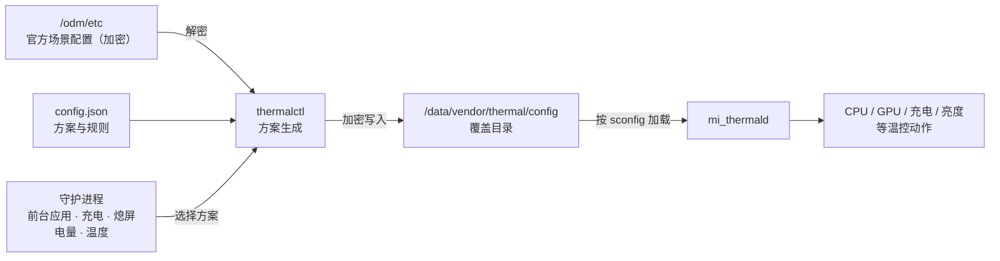

<div align="center">

# 小米温控调度

**Mi Thermal Scheduler**

面向小米 / Redmi 设备的 KernelSU 温控调度模块

基于 `mi_thermald` 官方场景配置覆盖机制 · Rust 后端 · Material 3 WebUI

[](https://github.com/MiChongs/MiThermalScheduler/releases/latest)
[](https://github.com/MiChongs/MiThermalScheduler/releases)
[](LICENSE)
<br>


[功能特性](#-功能特性) · [内置方案](#-内置方案) · [安装](#-安装) · [使用指南](#-使用指南) · [工作原理](#-工作原理) · [从源码构建](#-从源码构建) · [常见问题](#-常见问题)

</div>

---

## 📖 简介

**小米温控调度** 是一款运行于 KernelSU 的温控管理模块。模块通过 `mi_thermald` 原生支持的覆盖目录 `/data/vendor/thermal/config` 生效，**不修改任何系统分区**；所有温控配置均在运行时基于本机官方配置实时生成，系统更新后依然保持有效。

模块提供多套经过设计的预设方案，并支持按前台应用与系统状态自动切换、过热保护、充电加速、应用刷新率锁定、Joyose 游戏调度调教、覆盖文件自愈，以及细化到单条规则、单个档位的可视化编辑。

> [!IMPORTANT]
> 调整温控会改变设备的发热与功耗表现。请在充分了解风险的前提下使用，并建议始终保持「过热保护」开启。

## ✨ 功能特性

<table>
<tr>
<td width="50%" valign="top">

### 🎛️ 方案管理
- 8 套内置方案，覆盖续航、日常、游戏、快充等场景
- 自定义方案：分类阈值偏移、规则移除
- CPU 降频下限、GPU 降频等级上限
- 场景锁定与逐场景独立设置
- 逐条规则、逐档位编辑触发 / 解除温度与目标值
- 应用前生成预览，与官方配置对比

</td>
<td width="50%" valign="top">

### 🤖 自动调度
- 常驻守护进程，按规则自动切换方案
- 触发条件：前台应用、充电、熄屏、低电量、高温
- 规则按顺序匹配，支持启停与排序
- 温度与电量条件内置回差，避免频繁切换
- 应用刷新率：指定应用在前台时锁定刷新率上限
- 充电加速：充电时放宽充电限流，亮屏使用也能保持快充
- Joyose 调教：放宽游戏温控限帧、提高游戏 CPU 上限
- 模块描述实时显示运行状态

</td>
</tr>
<tr>
<td width="50%" valign="top">

### 🛡️ 安全机制
- 过热保护：超过阈值时临时切回官方温控
- 写入后校验，`mi_thermald` 无法解析时自动回滚
- 低电量保护（BCL）与传感器定义始终保留
- 覆盖文件被云控或系统改写时自动恢复
- 停用或卸载模块后立即恢复官方温控

</td>
<td width="50%" valign="top">

### 🎨 WebUI
- 基于 Lit 与 Material 3 组件构建
- 跟随 KernelSU 管理器动态取色与深色模式
- 温度仪表、温度趋势、频率上限实时监控
- 温控动作日志与模块日志
- 配置导入 / 导出

</td>
</tr>
</table>

## 📋 内置方案

| 方案 | 风险 | 说明 |
| :--- | :---: | :--- |
| **官方** | — | 完全使用系统自带的温控策略，不做任何修改 |
| **清凉** | 安全 | CPU / GPU / NPU 提前 3°C 降频，机身更凉、续航更长 |
| **轻度** | 安全 | CPU / GPU / NPU 降频阈值整体提高 3°C |
| **均衡** | 安全 | CPU / GPU / NPU 阈值 +6°C，亮度限制 +3°C |
| **性能** | 注意 | CPU / GPU / NPU 阈值 +10°C，亮度与网络限制同步放宽 |
| **游戏** | 注意 | 阈值 +8°C，大核降频下限 1.5 GHz，GPU 降频等级不超过 1 |
| **快充** | 注意 | 充电限流阈值 +4°C，其余保持官方 |
| **极限** | 高风险 | 移除 CPU / GPU / NPU 与亮度限制，仅保留充电、高温与低电量保护 |

内置方案不可直接修改，可在方案菜单中选择「基于此方案新建」后进行自定义。

## 📱 兼容性

| 项目 | 要求 |
| :--- | :--- |
| 设备 | 搭载 `mi_thermald` 的小米 / Redmi 设备（HyperOS / MIUI） |
| 架构 | arm64-v8a |
| Root 方案 | KernelSU（推荐，WebUI 依赖其接口）；Magisk 可安装但无 WebUI |
| 配置密钥 | 自动识别旧版（`thermalopenssl.h`）与新版密钥 |

安装时将自动检测设备是否受支持，不受支持的设备会中止安装且不做任何修改。

已验证设备：Xiaomi 14 Ultra（aurora · 骁龙 8 Gen 3 · HyperOS 4.0 · Android 17）

## 📦 安装

1. 前往 [Releases](https://github.com/MiChongs/MiThermalScheduler/releases/latest) 下载最新的 `MiThermalScheduler-vX.Y.Z.zip`。
2. 在 KernelSU 管理器的「模块」页面选择「从本地安装」，选取下载的 zip 文件。
3. 安装完成后重启设备。
4. 在模块列表中打开 **小米温控调度** 的 WebUI 进行配置。

> [!NOTE]
> 首次安装后模块处于待机状态，**不会改动任何温控**，直至在 WebUI 中启用。已配置的方案与自动化规则在模块更新后会被完整保留。

## 🧭 使用指南

WebUI 由五个页面组成：

| 页面 | 内容 |
| :--- | :--- |
| 概览 | 温度仪表、当前方案与原因、功能状态、温度趋势、频率上限、电池 |
| 温控 | 总开关、默认方案、场景规则、过热保护、充电加速 |
| 应用 | 应用配置（方案 + 刷新率）、刷新率锁定、游戏调度（Joyose） |
| 日志 | 温控动作与模块运行日志 |
| 设置 | 运行选项、配置导入导出、关于 |

### 方案选择顺序

守护进程按以下顺序决定当前方案，命中即停止：

1. **过热保护**：温度达到触发值时使用官方温控，降至恢复值以下后解除。
2. **应用配置**：前台应用设置了方案时使用该方案。
3. **场景规则**：按列表顺序匹配充电、熄屏、低电量、高温等条件。
4. **默认方案**。

充电时在选出的方案之上叠加充电加速。温控页顶部会实时标示当前生效的环节。

### 温控

- **默认方案**：轻触方案卡片设为默认方案；通过卡片菜单编辑、复制或删除自定义方案，或基于内置方案新建。
- **场景规则**：充电时、熄屏时、低电量、高温时切换到指定方案，按列表顺序匹配，可调整顺序。
- **过热保护**：设置触发温度与恢复温度（默认 48°C / 43°C）。
- **充电加速**：充电时放宽充电限流门限（默认 +4°C），可选移除 SIC-BAT 电流控制。官方从温控传感器约 33°C 起限流，亮屏使用时充电通常被限制在约 5 A；电量较高（约 75% 以上）时充电电流主要由电池本身决定。

方案编辑器包含五个部分：

| 页签 | 内容 |
| :--- | :--- |
| 基础 | 名称、描述、图标；8 类规则的「保持 / 偏移（−10 ~ +20°C）/ 移除」 |
| 频率 | 各 CPU 簇降频下限（可选频率取自设备）；GPU 最大降频等级 |
| 场景 | 场景锁定；逐场景设置为「跟随方案 / 保持官方 / 自定义全文」 |
| 规则 | 按场景浏览全部规则，逐条编辑档位或单独停用 |
| 预览 | 生成全部场景的最终配置，并与官方配置对比 |

### 应用

- **应用配置**：为一个或多个应用指定前台时使用的方案和刷新率上限，两者可任选其一或同时设置。
- **刷新率锁定**：HyperOS 的「电量与性能」会按场景动态限制刷新率（`miui_refresh_rate`），部分游戏会被限制在 60 Hz。锁定期间定期复核，被系统改写时自动恢复；应用离开前台后还原。默认在过热保护触发期间暂停锁定。
- **游戏调度 · Joyose**：调整小米游戏加速服务的温控限帧与游戏 CPU 上限。

| 项目 | 选项 | 说明 |
| :--- | :--- | :--- |
| 温控限帧 | 官方 / 放宽 / 关闭 | 放宽：所有温控限帧门限（含 PID 控温目标）整体上调；关闭：不再因温度降帧 |
| 游戏 CPU 上限 | 官方 / 提高 / 满频 | 提高：各簇上限不低于设定值；满频：使用 Joyose 自身的不限值 |

Joyose 调教以设备上最新的官方配置为基线生成，注入后重启 Joyose 生效；云控更新或配置被覆盖时自动重新应用；关闭开关、停用或卸载模块时还原官方配置。

> [!TIP]
> 刷新率锁定只决定系统允许的上限，游戏实际帧率仍取决于游戏内设置。请选择不超过屏幕最高刷新率的帧率档位，例如在 120 Hz 屏幕上选择 120 帧而非 144 帧。

### 日志与设置

- **日志**：查看 `mi_thermald` 最近的调节动作（可按 CPU / GPU / 充电筛选）及模块运行日志。
- **设置**：锁定覆盖文件（`chattr +i`）、检测间隔、重启守护进程、立即重新应用、导入 / 导出配置、查看当前加载的配置、恢复官方温控。

## ⚙️ 工作原理



1. `mi_thermald` 根据系统写入的场景编号（`sconfig`）加载对应的场景配置，并优先读取 `/data/vendor/thermal/config` 中的同名文件。
2. 场景配置采用 AES-128-CBC 加密。`thermalctl` 自动识别本机使用的密钥，解密官方配置后按方案生成新配置，再以相同密钥加密写入覆盖目录。
3. 写入后通过切换 `sconfig` 触发 `mi_thermald` 重新加载，并校验其能否正确解析；校验失败时自动回滚为官方温控。
4. 守护进程持续评估过热保护与自动化规则，在需要时切换方案，同时检查覆盖文件完整性。

方案生成流水线：

```text
官方配置 → 场景锁定 → 分类偏移 / 移除 → CPU 降频下限 → GPU 等级上限 → 单条规则覆盖 → 场景全文覆盖
```

传感器定义（`VIRTUAL-SENSOR` 等）与低电量保护（`BCL`）在任何方案下均保持不变。

## 🖥️ 命令行

模块附带的 `thermalctl` 可在终端中直接使用（需 root）：

```sh
/data/adb/modules/mi_thermal_m3/bin/thermalctl <命令>
```

| 命令 | 说明 |
| :--- | :--- |
| `summary` | 输出可读的状态摘要 |
| `status` | 实时状态（JSON） |
| `info` | 设备信息、配置、内置方案与频率表（JSON） |
| `scenes` | 官方场景配置的结构化数据（JSON） |
| `preview [--profile ID] [--scene 文件]` | 预览方案生成结果 |
| `save <文件>` | 保存配置并立即生效 |
| `apply` | 重新应用当前配置 |
| `reset` | 关闭总开关并恢复官方温控 |
| `log [-n 数量]` | 温控动作与模块日志（JSON） |
| `loaded` | `mi_thermald` 当前加载的配置 |
| `decrypt <文件>` / `encrypt <输入> <输出>` | 解密 / 加密温控配置 |
| `daemon` | 运行守护进程（由 `service.sh` 自动启动） |

## 🗂️ 目录结构

```text
MiThermalScheduler
├── module/              模块本体（customize / service / uninstall 等脚本）
├── thermalctl/          Rust 后端与守护进程
│   └── src/
│       ├── crypto.rs    配置加解密与密钥识别
│       ├── conf.rs      配置解析、序列化与规则分类
│       ├── stock.rs     官方场景配置读取
│       ├── profile.rs   方案、自动化规则与生成流水线
│       ├── install.rs   覆盖文件写入、校验与回滚
│       ├── daemon.rs    守护进程
│       ├── refresh.rs   应用刷新率锁定
│       ├── joyose.rs    Joyose 云控配置调教
│       └── system.rs    温度、频率、电池与前台应用采集
├── webui/               Material 3 WebUI（Lit + esbuild）
├── build.sh             一键构建与打包
├── update.json          KernelSU 在线更新信息
└── CHANGELOG.md         更新日志
```

运行时数据位于 `/data/adb/mi_thermal_m3/`，包括 `config.json`（方案与规则）、`state.json`（守护进程状态）与 `module.log`（运行日志）。

## 🔨 从源码构建

**环境要求**

- Rust（stable）及 `aarch64-linux-android` 目标
- Android NDK（通过 `ANDROID_NDK_HOME` 指定，或安装于 `~/Android/Sdk/ndk`）
- Node.js 18 及以上
- `zip`

**构建**

```sh
git clone https://github.com/MiChongs/MiThermalScheduler.git
cd MiThermalScheduler
./build.sh
```

构建脚本依次执行单元测试、交叉编译 `thermalctl`、构建 WebUI，并输出模块安装包至 `dist/`。

## ❓ 常见问题

<details>
<summary><b>启用后温度没有明显变化？</b></summary>

温控规则仅在达到对应温度时才会触发。可在「日志」页查看 `mi_thermald` 的实际调节动作，或在「设置 → 查看当前加载的配置」中确认覆盖是否生效。
</details>

<details>
<summary><b>游戏帧率被限制在 60 帧怎么办？</b></summary>

先确认游戏内帧率档位不超过屏幕最高刷新率；若使用机型伪装模块，游戏可能提供 144 帧等本机不支持的档位，此时应选择 120 帧档位。随后在「应用」页为该游戏添加应用配置并设置 120 Hz，即可避免「电量与性能」将其限制为 60 Hz。
</details>

<details>
<summary><b>亮屏充电速度慢怎么办？</b></summary>

在「温控 → 充电加速」中启用充电加速。若边充电边游戏时仍偏慢，可开启「移除 SIC 电流控制」，并留意机身温度。电量较高时充电电流由电池本身限制，属于正常现象。
</details>

<details>
<summary><b>系统更新后需要重新配置吗？</b></summary>

不需要。方案在运行时基于当前系统的官方配置实时生成，系统更新后会自动适配。仅「自定义全文」方式设置的场景需要自行确认内容。
</details>

<details>
<summary><b>如何确认守护进程正在运行？</b></summary>

模块描述会实时显示运行状态；也可在「设置」中查看守护进程 PID，或在模块页点击「执行」查看状态摘要。
</details>

<details>
<summary><b>过热保护以哪个温度为准？</b></summary>

以 `mi_thermald` 使用的温控传感器 `VIRTUAL-SENSOR0` 为准，该值由电池、机身等多个传感器加权得出，近似反映机身温度。
</details>

<details>
<summary><b>如何完全恢复官方温控？</b></summary>

在「设置」中选择「恢复官方温控」，或直接在管理器中停用 / 卸载模块。模块会立即删除全部覆盖文件，并还原安装前已存在的同名配置。
</details>

## 🧹 卸载

在 KernelSU 管理器中卸载模块并重启即可。卸载流程会停止守护进程、删除全部覆盖文件、还原安装前的配置，并清除运行时数据。

## ⚠️ 免责声明

本模块按「现状」提供，不附带任何形式的担保。修改温控策略可能导致设备温度升高、电池老化加速或性能表现变化，由此产生的任何后果由使用者自行承担。本项目与小米公司无任何关联。

## 📄 许可证

本项目基于 [GNU General Public License v3.0](LICENSE) 发布。
